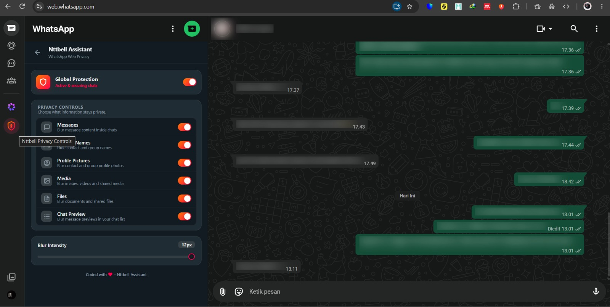

# 🛡️ Nttbell Assistant - WhatsApp Web Privacy Extension (v1.0)

## 📸 Preview

Nttbell Assistant membantu menjaga privasi percakapan dengan memburamkan informasi sensitif pada WhatsApp Web.

<p align="center">
  
</p>

Nttbell Assistant adalah ekstensi peramban (_browser extension_) yang dirancang untuk membantu menjaga privasi layar saat menggunakan WhatsApp Web di tempat umum, lingkungan kerja, kampus, maupun ruang bersama.

Nttbell Assistant bekerja dengan memberikan lapisan perlindungan visual berupa efek _blur_ pada informasi tertentu di WhatsApp Web. Pengguna dapat memilih kategori informasi yang ingin dilindungi dan menyesuaikan tingkat _blur_ sesuai kebutuhan.

Extension ini berjalan secara lokal pada browser dan tidak membutuhkan backend, database, maupun server eksternal.

---

## ✨ Fitur Utama

- **Global Protection Toggle**
  Mengaktifkan atau menonaktifkan perlindungan privasi secara keseluruhan.

- **Granular Privacy Controls**
  Memilih kategori informasi yang ingin dilindungi secara individual:
  - Messages
  - Contact Names
  - Profile Pictures
  - Media
  - Files
  - Chat Preview

- **Adjustable Blur Intensity**
  Mengatur tingkat kekuatan efek _blur_ menggunakan slider.

- **Hover to Reveal**
  Informasi yang sedang diburamkan dapat terlihat sementara ketika kursor diarahkan ke elemen tersebut. Blur akan kembali ketika kursor meninggalkan elemen.

- **Native & Seamless UI**
  Antarmuka dirancang agar menyatu dengan pengalaman penggunaan WhatsApp Web serta mendukung tampilan _Light Mode_ dan _Dark Mode_.

- **WhatsApp Web Navigation Integration**
  Nttbell tersedia langsung pada navigasi WhatsApp Web dan ditempatkan di bawah Meta AI.

- **Local Storage**
  Preferensi pengguna disimpan secara lokal menggunakan Chrome Storage dan tidak membutuhkan database eksternal.

---

## 🛠️ Tech Stack

Extension ini dibangun menggunakan teknologi web modern dengan fokus pada performa, keamanan, dan pemeliharaan kode.

| Teknologi                | Kegunaan                                                            |
| :----------------------- | :------------------------------------------------------------------ |
| **TypeScript**           | Menulis logika extension dengan pendekatan _type-safe_ dan modular. |
| **CSS3**                 | Mengatur tampilan, responsive design, animasi, dan efek visual.     |
| **Chrome Extension API** | Menyediakan fitur extension berdasarkan standar Manifest V3.        |
| **Vite**                 | Digunakan sebagai build tool untuk menghasilkan production build.   |
| **DOM MutationObserver** | Memantau perubahan DOM WhatsApp Web secara dinamis.                 |
| **Chrome Storage API**   | Menyimpan konfigurasi privacy pengguna secara lokal.                |

---

# 📦 Instalasi

Nttbell Assistant saat ini dapat digunakan dengan cara **Load Unpacked Extension** karena belum dipublikasikan melalui Chrome Web Store.

Ada dua cara untuk mendapatkan project:

### Opsi A — Download ZIP

1. Buka repository Nttbell Assistant di GitHub.
2. Klik tombol **`<> Code`**.
3. Pilih **Download ZIP**.
4. Ekstrak file ZIP ke folder yang mudah ditemukan.

### Opsi B — Git Clone

Untuk developer, repository dapat di-clone menggunakan Git:

```bash
git clone https://github.com/notbell1/nttbell-assistant
cd nttbell-assistant
```

---

# ⚙️ Install Dependencies

Setelah project berhasil diunduh, buka terminal pada folder project.

Contoh menggunakan PowerShell:

```powershell
cd E:\nttbell-assistant
```

Kemudian install seluruh dependency:

```powershell
npm install
```

Pastikan Node.js dan npm sudah terpasang pada komputer.

---

# 🔨 Build Extension

Sebelum extension di-import ke Chrome, lakukan proses build terlebih dahulu.

### 1. Type Check

Jalankan:

```powershell
npm run typecheck
```

Jika tidak terdapat error, lanjutkan ke proses build.

### 2. Production Build

Jalankan:

```powershell
npm run build
```

Jika berhasil, folder:

```text
dist
```

akan dibuat secara otomatis.

Folder `dist` merupakan folder hasil build yang digunakan untuk memasang extension ke Chrome.

---

# 🌐 Import ke Google Chrome

Setelah proses build selesai, extension dapat di-import secara manual.

### 1. Buka Chrome Extensions

Buka Google Chrome dan masuk ke:

```text
chrome://extensions
```

### 2. Aktifkan Developer Mode

Aktifkan tombol:

**Developer mode**

Biasanya terdapat di bagian kanan atas halaman Extensions.

### 3. Pilih Load Unpacked

Klik:

**Load unpacked**

### 4. Pilih Folder `dist`

Cari folder hasil build Nttbell Assistant.

Contoh:

```text
E:\nttbell-assistant\dist
```

Pilih folder tersebut.

> Jangan memilih folder `src`. Chrome harus diarahkan ke folder `dist` yang berisi hasil production build.

### 5. Extension Berhasil Dipasang

Setelah berhasil, **Nttbell Assistant** akan muncul pada daftar extension Chrome.

Extension sekarang siap digunakan pada WhatsApp Web.

---

# 💬 Cara Penggunaan

### 1. Buka WhatsApp Web

Buka WhatsApp Web menggunakan Google Chrome.

### 2. Temukan Nttbell Assistant

Setelah extension aktif, menu **Nttbell Assistant** akan muncul pada navigasi WhatsApp Web, tepat di bawah **Meta AI**.

### 3. Buka Nttbell Assistant

Klik menu **Nttbell Assistant** untuk membuka halaman pengaturan privacy.

### 4. Pilih Perlindungan

Aktifkan kategori privacy yang dibutuhkan.

Tersedia beberapa kategori:

- **Messages** — memburamkan teks pesan.
- **Contact Names** — memburamkan nama kontak dan grup.
- **Profile Pictures** — memburamkan foto profil.
- **Media** — memburamkan media seperti foto dan video.
- **Files** — memburamkan file atau dokumen.
- **Chat Preview** — memburamkan preview pesan pada daftar chat.

### 5. Atur Blur Intensity

Gunakan slider **Blur Intensity** untuk menentukan seberapa kuat efek blur.

### 6. Hover untuk Melihat Konten

Arahkan kursor ke informasi yang sedang diburamkan untuk melihatnya sementara.

Ketika kursor meninggalkan elemen tersebut, perlindungan blur akan kembali secara otomatis.

---

# 🔄 Setelah Mengubah Source Code

Jika source code mengalami perubahan, lakukan build ulang:

```powershell
npm run typecheck
npm run build
```

Kemudian:

1. Buka `chrome://extensions`.
2. Cari **Nttbell Assistant**.
3. Klik **Reload**.
4. Kembali ke WhatsApp Web.
5. Refresh halaman WhatsApp Web.

Jika diperlukan, gunakan:

```text
Ctrl + Shift + R
```

untuk melakukan _hard refresh_.

---

# 💾 Penyimpanan Pengaturan

Nttbell Assistant menggunakan **Chrome Storage API** untuk menyimpan konfigurasi pengguna.

Pengaturan disimpan menggunakan:

```text
chrome.storage.local
```

Tidak diperlukan:

- Akun Login
- Database
- Backend
- Server eksternal
- Supabase
- API pihak ketiga

Pengaturan yang disimpan meliputi status setiap kategori privacy dan tingkat blur.

---

# 🔐 Privasi & Keamanan

Nttbell Assistant dibuat sebagai **visual privacy tool** untuk membantu mengurangi kemungkinan informasi pribadi terlihat oleh orang di sekitar pengguna.

Extension ini tidak dirancang untuk:

- Mengambil password WhatsApp.
- Mengambil session token.
- Mengambil credential pengguna.
- Mengirim isi percakapan ke server eksternal.
- Menyimpan isi percakapan pada database eksternal.
- Menggunakan backend untuk memproses pesan.
- Mengakses sistem keamanan internal WhatsApp.

Seluruh pengaturan privacy disimpan secara lokal melalui Chrome Storage.

---

# ⚠️ Catatan

Nttbell Assistant bergantung pada struktur antarmuka WhatsApp Web.

WhatsApp Web dapat melakukan perubahan pada struktur DOM, atribut, maupun mekanisme rendering antarmukanya. Perubahan tersebut dapat menyebabkan beberapa fitur extension perlu diperbarui agar tetap kompatibel.

Nttbell Assistant merupakan perlindungan visual dan **bukan mekanisme enkripsi atau keamanan end-to-end tambahan** untuk WhatsApp.

---

# 🧪 Development

Untuk melakukan pengembangan:

```powershell
npm install
```

Type checking:

```powershell
npm run typecheck
```

Build:

```powershell
npm run build
```

Development server:

```powershell
npm run dev
```

Setelah melakukan perubahan, lakukan build kembali dan **Reload** extension melalui `chrome://extensions`.

---

# 📋 Default Settings

Pada instalasi baru, seluruh kategori privacy dalam keadaan **OFF**.

| Pengaturan         | Default |
| :----------------- | :------ |
| Privacy Protection | OFF     |
| Messages           | OFF     |
| Contact Names      | OFF     |
| Profile Pictures   | OFF     |
| Media              | OFF     |
| Files              | OFF     |
| Chat Preview       | OFF     |
| Blur Intensity     | 6px     |

Pengguna dapat mengaktifkan kategori privacy yang dibutuhkan tanpa harus mengaktifkan seluruh kategori.

---

# 👨‍💻 Credit

**Nttbell Assistant**

Developed by:

**NttBell**

Project focus:

> Privacy-focused browser extension for WhatsApp Web.

Teknologi dan library pihak ketiga yang digunakan dalam project ini tetap menjadi hak dan kepemilikan masing-masing pembuatnya.

WhatsApp dan Meta merupakan merek dagang dari pemiliknya masing-masing.

Nttbell Assistant **bukan produk resmi, tidak berafiliasi, dan tidak didukung oleh WhatsApp maupun Meta**.

---

# 📄 License

Project ini merupakan project pribadi.

Hak penggunaan, distribusi, dan modifikasi mengikuti lisensi yang ditentukan oleh pemilik repository.
