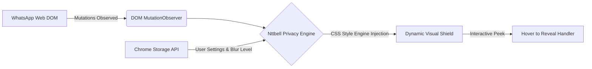

<p align="center">
  
</p>

<h1 align="center">🛡️ Nttbell Assistant</h1>

<p align="center">
  <strong>Next-Generation Privacy & Screen Shield for WhatsApp Web</strong><br>
  <em>Perlindungan visual privasi percakapan tingkat lanjut — bebas intipan di tempat umum, kantor, dan presentasi.</em>
</p>

<p align="center">
  <a href="https://github.com/notbell1/nttbell-assistant/blob/main/LICENSE">
    
  </a>
  <a href="https://www.typescriptlang.org/">
    
  </a>
  <a href="https://vitejs.dev/">
    
  </a>
  <a href="https://developer.chrome.com/docs/extensions/mv3/intro/">
    
  </a>
  <a href="#">
    
  </a>
</p>

<p align="center">
  <a href="#-preview--tampilan">📸 Preview</a> •
  <a href="#-fitur-unggulan">✨ Fitur Utama</a> •
  <a href="#-panduan-instalasi">📦 Instalasi</a> •
  <a href="#-cara-penggunaan">💬 Penggunaan</a> •
  <a href="#-arsitektur--teknologi">🛠️ Arsitektur</a> •
  <a href="#-keamanan--privasi">🔐 Privasi</a> •
  <a href="#-lisensi">📄 Lisensi</a>
</p>

---

## 🌟 Tentang Nttbell Assistant

**Nttbell Assistant** adalah ekstensi browser modern berperforma tinggi yang dirancang khusus untuk melindungi layar WhatsApp Web Anda dari pandangan orang lain (*shoulder surfing*). Baik saat bekerja di kafe, co-working space, ruang kuliah, maupun saat sedang melakukan *screen sharing* / presentasi daring.

Dibuat dengan standar **Chrome Manifest V3**, ekstensi ini menyatu secara natural (*native seamless integration*) dengan antarmuka WhatsApp Web tanpa merusak tata letak asli, serta beroperasi **100% secara lokal** tanpa ketergantungan server eksternal, backend, maupun analitik.

> 💡 **Prinsip Utama:** Privasi total visual Anda adalah prioritas. Anda memiliki kontrol penuh atas apa yang ingin Anda sembunyikan dan kapan Anda ingin melihatnya.

---

## 📸 Preview & Tampilan

Lihat bagaimana Nttbell Assistant mengaburkan informasi sensitif secara elegan dan seketika:

<p align="center">
  
</p>

---

## ✨ Fitur Unggulan

<table>
  <tr>
    <td width="50%">
      <h3>🛡️ Master Privacy Toggle</h3>
      <p>Aktifkan atau nonaktifkan seluruh proteksi privasi hanya dengan satu klik instan kapan pun Anda membutuhkannya.</p>
    </td>
    <td width="50%">
      <h3>🎯 Granular Privacy Controls</h3>
      <p>Pilih elemen spesifik yang ingin disamarkan secara independen tanpa membatasi elemen lainnya.</p>
    </td>
  </tr>
  <tr>
    <td width="50%">
      <h3>🎚️ Dynamic Blur Intensity</h3>
      <p>Atur tingkat ketebalan efek blur secara presisi dari halus (subtle) hingga buram total melalui slider interaktif.</p>
    </td>
    <td width="50%">
      <h3>👁️ Smart Hover to Reveal</h3>
      <p>Arahkan kursor pada elemen yang diburamkan untuk melihat isinya sementara. Blur akan langsung aktif kembali saat kursor menjauh.</p>
    </td>
  </tr>
  <tr>
    <td width="50%">
      <h3>🎨 Native Seamless UI Dock</h3>
      <p>Menu Nttbell tertanam rapi di bilah navigasi WhatsApp Web (tepat di bawah Meta AI) dan mendukung adaptasi tema <em>Light & Dark Mode</em>.</p>
    </td>
    <td width="50%">
      <h3>⚡ Zero External Footprint</h3>
      <p>Tidak ada database eksternal, tidak ada API tracking, dan tidak ada server luar. Semua konfigurasi tersimpan aman di peramban Anda.</p>
    </td>
  </tr>
</table>

### 🧩 Kategori Proteksi yang Didukung

| Kategori | Deskripsi Proteksi |
| :--- | :--- |
| 💬 **Messages** | Memburamkan seluruh isi teks percakapan di dalam ruang obrolan. |
| 👤 **Contact Names** | Menyembunyikan nama kontak dan grup agar tidak terbaca oleh orang sekitar. |
| 🖼️ **Profile Pictures** | Memburamkan foto profil (*avatar*) di daftar kontak maupun header chat. |
| 📸 **Media** | Menyembunyikan preview gambar, video, dan animasi stiker. |
| 📁 **Files & Documents** | Memburamkan nama dan lampiran dokumen yang dikirimkan. |
| 👁️ **Chat Preview** | Mengaburkan cuplikan pesan terakhir pada daftar obrolan di bilah sisi (*sidebar*). |

---

## 🛠️ Arsitektur & Teknologi

Nttbell Assistant dibangun dengan standar arsitektur modern berorientasi performa tinggi dan nol *latency*:



### 🧰 Tech Stack

- **Core:** [TypeScript](https://www.typescriptlang.org/) — Menjamin kode yang *type-safe*, modular, dan kokoh.
- **Build Tool:** [Vite](https://vitejs.dev/) — Bundling super cepat dengan output distribusi yang teroptimasi.
- **Platform:** [Chrome Extension Manifest V3](https://developer.chrome.com/docs/extensions/mv3/intro/) — Standar keamanan dan efisiensi memori ekstensi Chrome terbaru.
- **Styling:** CSS3 Hardware-Accelerated Filters (`backdrop-filter` & `filter: blur()`).
- **Reactive Engine:** Native DOM `MutationObserver` untuk mendeteksi perubahan dinamis chat WhatsApp Web secara *real-time*.
- **State Persistence:** `chrome.storage.local` untuk menyimpan preferensi tanpa latensi jaringan.

---

## 📦 Panduan Instalasi

Karena Nttbell Assistant didistribusikan secara *open-source*, Anda dapat memasangnya langsung ke Google Chrome atau browser berbasis Chromium lainnya (Edge, Brave, Opera, Arc).

### 1️⃣ Unduh / Clone Repository

Gunakan Git CLI:
```bash
git clone https://github.com/notbell1/nttbell-assistant.git
cd nttbell-assistant
```

*Atau unduh file ZIP melalui tombol hijau **`Code` ➜ `Download ZIP`** di GitHub dan ekstrak foldernya.*

---

### 2️⃣ Pasang Dependencies

Pastikan Anda telah menginstal [Node.js](https://nodejs.org/) (versi 18+ disarankan). Jalankan perintah berikut di terminal:

```bash
npm install
```

---

### 3️⃣ Kompilasi / Build Ekstensi

Jalankan perintah build untuk menghasilkan paket siap pakai:

```bash
# Validasi tipe TypeScript
npm run typecheck

# Kompilasi production build
npm run build
```

Setelah selesai, folder distribusi `dist/` akan otomatis terbuat di root proyek.

---

### 4️⃣ Pasang Ekstensi ke Google Chrome

1. Buka browser **Google Chrome**.
2. Masuk ke halaman pengelolaan ekstensi:
   ```text
   chrome://extensions/
   ```
3. Aktifkan tombol **Developer mode** di pojok kanan atas.
4. Klik tombol **Load unpacked** di pojok kiri atas.
5. Arahkan dan pilih folder **`dist`** hasil kompilasi (bukan folder `src`).
6. 🎉 **Nttbell Assistant** kini telah terpasang dan aktif!

---

## 💬 Cara Penggunaan

```text
1. Buka WhatsApp Web (web.whatsapp.com)
   └── Pastikan ekstensi Nttbell Assistant aktif

2. Akses Menu Nttbell
   └── Temukan ikon perisai Nttbell di panel navigasi kiri (di bawah Meta AI)

3. Kustomisasi Privasi
   ├── Aktifkan Master Privacy Protection
   ├── Centang kategori yang ingin Anda sembunyikan (Messages, Contacts, dll.)
   └── Geser slider Blur Intensity sesuai kenyamanan mata Anda

4. Mode Pengintipan (Hover-to-Reveal)
   └── Arahkan kursor ke elemen blur untuk melihat isi sementara
```

---

## ⚙️ Pengaturan Standar (Default)

Saat pertama kali dipasang, ekstensi berada dalam mode *clean state* untuk kenyamanan Anda:

| Parameter | Pengaturan Default | Penjelasan |
| :--- | :---: | :--- |
| **Privacy Protection** | `OFF` | Master switch dinonaktifkan pada awal pasang |
| **Messages** | `OFF` | Pengguna memilih secara bebas saat dibutuhkan |
| **Contact Names** | `OFF` | Menyembunyikan identitas lawan bicara |
| **Profile Pictures** | `OFF` | Mengaburkan foto avatar |
| **Media** | `OFF` | Mengaburkan konten gambar & video |
| **Files** | `OFF` | Mengaburkan berkas dokumen |
| **Chat Preview** | `OFF` | Mengaburkan daftar obrolan sisi kiri |
| **Blur Intensity** | `6px` | Nilai seimbang antara keterbacaan & privasi |

---

## 🔄 Alur Pengembangan (Development)

Bagi kontributor yang ingin mengembangkan fitur baru:

```bash
# Jalankan mode pengembangan Vite
npm run dev

# Jalankan typecheck saat ada perubahan tipe
npm run typecheck

# Kompilasi ulang aset
npm run build
```

> **Tips Reload:** Setelah melakukan *build*, buka `chrome://extensions/` dan klik ikon **🔄 Reload** pada kartu Nttbell Assistant, lalu lakukan *hard refresh* di WhatsApp Web (`Ctrl + Shift + R` atau `Cmd + Shift + R`).

---

## 🔐 Komitmen Privasi & Keamanan

Kepercayaan pengguna adalah fondasi dari proyek ini. Kami menerapkan arsitektur **Zero-Knowledge & Zero-Data-Collection**:

- 🚫 **No Tracking:** Ekstensi tidak memiliki tracker, Google Analytics, atau skrip telemetri apa pun.
- 🚫 **No Remote Calls:** Tidak ada permintaan jaringan (*network request*) yang dikirim ke server pihak ketiga.
- 🚫 **No Credential Access:** Ekstensi tidak pernah membaca token, sandi, cookie, atau sesi autentikasi akun Anda.
- 🚫 **No Message Storage:** Isi obrolan Anda tidak pernah disimpan ke mana pun.
- 🛡️ **Pure Client-Side:** Seluruh operasi dijalankan murni di browser Anda melalui manipulasi gaya CSS visual.

---

## ⚠️ Disklaimer & Batasan

- **Visual Shield Only:** Nttbell Assistant dirancang murni sebagai *visual obfuscation tool* (penghalang visual dari pandangan mata orang sekitar). Ekstensi ini **bukan** pengganti enkripsi end-to-end atau protokol keamanan akun.
- **WhatsApp UI Updates:** WhatsApp Web sewaktu-waktu dapat memperbarui struktur elemen DOM mereka. Jika terjadi perubahan selektor, silakan ajukan *Issue* atau *Pull Request* agar penyesuaian selektor dapat segera diperbarui.
- **Afiliasi:** Nttbell Assistant adalah proyek independen dan **tidak berafiliasi, disponsori, atau disetujui secara resmi oleh WhatsApp LLC atau Meta Platforms, Inc.**

---

## 🤝 Kontribusi

Kontribusi dari komunitas selalu diterima dengan senang hati!

1. **Fork** repository ini.
2. Buat branch fitur baru (`git checkout -b feature/FiturKeren`).
3. Lakukan commit perubahan Anda (`git commit -m 'feat: Menambahkan fitur filter baru'`).
4. Push ke branch Anda (`git push origin feature/FiturKeren`).
5. Buat **Pull Request**.

---

## 👨‍💻 Author & Pengembang

<p align="left">
  <strong>NttBell</strong> (<em>Notbell1</em>)<br>
  GitHub: <a href="https://github.com/notbell1">@notbell1</a>
</p>

---

## 📄 Lisensi

Proyek ini didistribusikan di bawah lisensi resmi **[MIT License](LICENSE)**. Anda memiliki kebebasan untuk menggunakan, memodifikasi, dan mendistribusikan perangkat lunak ini sesuai dengan ketentuan lisensi.

<p align="center">
  <sub>Dibangun dengan ❤️ untuk privasi digital yang lebih baik.</sub>
</p>
