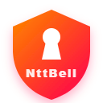
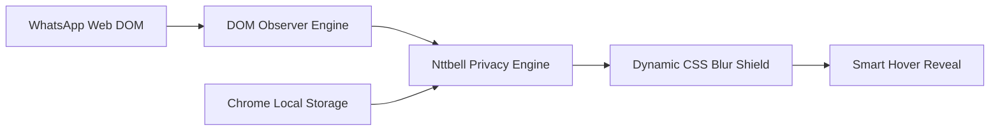

<div align="center">

  

  # 🛡️ Nttbell Assistant
  
  **Next-Generation Visual Privacy & Screen Shield for WhatsApp Web**
  
  *Perlindungan visual privasi percakapan tingkat lanjut — aman dari intipan layar di tempat umum, kantor, dan presentasi.*

  <p>
    <a href="LICENSE">
      
    </a>
    <a href="https://www.typescriptlang.org/">
      
    </a>
    <a href="https://vite.dev/">
      
    </a>
    <a href="https://developer.chrome.com/docs/extensions/mv3/intro/">
      
    </a>
    <a href="#keamanan">
      
    </a>
  </p>

  <p>
    <a href="#preview">📸 Preview</a> &nbsp;•&nbsp;
    <a href="#fitur">✨ Fitur Utama</a> &nbsp;•&nbsp;
    <a href="#arsitektur">🛠️ Arsitektur</a> &nbsp;•&nbsp;
    <a href="#instalasi">📦 Instalasi</a> &nbsp;•&nbsp;
    <a href="#penggunaan">💬 Penggunaan</a> &nbsp;•&nbsp;
    <a href="#keamanan">🔐 Privasi</a> &nbsp;•&nbsp;
    <a href="#lisensi">📄 Lisensi</a>
  </p>

</div>

---

<a id="preview"></a>
## 📸 Preview Tampilan

Perlindungan visual instan dan adaptif terhadap seluruh elemen sensitif di WhatsApp Web:

<p align="center">
  
</p>

---

<a id="tentang"></a>
## 🌟 Tentang Nttbell Assistant

**Nttbell Assistant** adalah ekstensi browser modern berperforma tinggi yang dirancang khusus untuk melindungi layar WhatsApp Web Anda dari pandangan orang sekitar (*shoulder surfing*). Solusi sempurna saat Anda:

- ☕ Bekerja di kafe atau ruang publik (*co-working space*).
- 🏢 Berada di kantor, ruang rapat, atau kelas kampus.
- 🖥️ Melakukan *screen sharing* saat presentasi daring (*Google Meet, Zoom, Teams*).

Dibangun di atas arsitektur **Chrome Manifest V3**, Nttbell Assistant terintegrasi mulus (*native dock UI*) di bilah navigasi WhatsApp Web dan beroperasi **100% lokal** di peramban Anda tanpa pengiriman data ke server eksternal mana pun.

---

<a id="fitur"></a>
## ✨ Fitur Utama

- 🛡️ **Master Privacy Toggle** — Saklar utama untuk mengaktifkan atau menonaktifkan seluruh perlindungan dengan sekali klik.
- 🎯 **Granular Privacy Filter** — Kebebasan memilih elemen apa saja yang ingin diburamkan sesuai kebutuhan:
  - 💬 **Messages:** Menyembunyikan seluruh isi balon pesan teks.
  - 👤 **Contact Names:** Menyamarkan nama kontak pribadi maupun grup obrolan.
  - 🖼️ **Profile Pictures:** Mengaburkan foto profil / avatar kontak.
  - 📸 **Media Content:** Memburamkan pratinjau gambar, video, dan stiker.
  - 📁 **Files & Documents:** Menyamarkan nama file dan dokumen lampiran.
  - 👁️ **Chat List Preview:** Memburamkan cuplikan pesan terakhir di daftar chat sebelah kiri.
- 🎚️ **Adjustable Blur Intensity** — Kendali presisi tingkat ketebalan efek blur melalui slider interaktif (default: `6px`).
- 👁️ **Smart Hover-to-Reveal** — Arahkan kursor (*hover*) pada elemen yang diburamkan untuk melihat konten sementara tanpa perlu mematikan perlindungan.
- 🎨 **Native WhatsApp Web Integration** — Tombol menu tertanam rapi di bilah navigasi kiri WhatsApp Web (tepat di bawah Meta AI) serta mendukung *Light Mode* & *Dark Mode*.
- ⚡ **Zero External Latency** — Berjalan mandiri tanpa database eksternal, akun login, maupun API pihak ketiga.

---

<a id="arsitektur"></a>
## 🛠️ Arsitektur & Cara Kerja

Nttbell Assistant mengamati perubahan DOM WhatsApp Web secara reaktif dan menerapkan filter CSS perangkat keras (*hardware-accelerated CSS blur*) secara instan:



### 🧰 Spesifikasi Teknologi

| Komponen | Spesifikasi & Penggunaan |
| :--- | :--- |
| **Bahasa Pemrograman** | [TypeScript 5.9](https://www.typescriptlang.org/) — Menjamin kode yang *type-safe* dan modular |
| **Build Tool** | [Vite 7.1](https://vite.dev/) — Kompilasi super cepat dan optimasi bundle produksi |
| **Ekstensi Standar** | [Chrome Manifest V3](https://developer.chrome.com/docs/extensions/mv3/intro/) — Efisien memori dan memenuhi standar Chrome modern |
| **Reactive Observer** | Native `MutationObserver` — Mendeteksi chat baru secara *real-time* tanpa lag |
| **Penyimpanan Lokal** | `chrome.storage.local` — Menyimpan preferensi pengguna langsung di browser |

---

<a id="instalasi"></a>
## 📦 Panduan Instalasi

Nttbell Assistant dapat dipasang langsung pada Google Chrome, Microsoft Edge, Brave, Opera, atau browser berbasis Chromium lainnya.

### Langkah 1: Clone atau Download Repository

```bash
git clone https://github.com/notbell1/nttbell-assistant.git
cd nttbell-assistant
```

*(Atau klik tombol hijau **Code** ➜ **Download ZIP**, kemudian ekstrak foldernya).*

### Langkah 2: Install Dependensi

Pastikan [Node.js](https://nodejs.org/) sudah terpasang di komputer Anda.

```bash
npm install
```

### Langkah 3: Build Ekstensi

Jalankan perintah kompilasi produksi:

```bash
# Validasi tipe
npm run typecheck

# Kompilasi paket ekstensi
npm run build
```

Setelah proses selesai, folder `dist` akan otomatis dibuat.

### Langkah 4: Load Unpacked ke Google Chrome

1. Buka browser **Google Chrome**.
2. Kunjungi halaman ekstensi:
   ```text
   chrome://extensions/
   ```
3. Aktifkan toggle **Developer mode** di pojok kanan atas.
4. Klik tombol **Load unpacked** di pojok kiri atas.
5. Pilih folder **`dist`** hasil build (bukan folder root atau src).
6. Ekstensi **Nttbell Assistant** kini siap digunakan!

---

<a id="penggunaan"></a>
## 💬 Cara Penggunaan

1. Buka [WhatsApp Web](https://web.whatsapp.com/) di browser Chrome Anda.
2. Temukan dan klik ikon perisai **Nttbell Assistant** di bilah navigasi kiri (tepat di bawah Meta AI).
3. Panel kontrol privasi akan terbuka:
   - Aktifkan **Privacy Protection** sebagai saklar utama.
   - Pilih kategori informasi yang ingin Anda buramkan.
   - Atur slider **Blur Intensity** sesuai tingkat keamanan visual yang diinginkan.
4. **Mode Peek (Hover):** Saat ingin membaca pesan atau melihat foto yang disamarkan, cukup arahkan kursor mouse ke elemen tersebut. Konten akan kembali buram saat kursor menjauh.

---

<a id="default-settings"></a>
## 📋 Konfigurasi Bawaan (Default Settings)

Saat pertama kali dipasang, konfigurasi bawaan adalah sebagai berikut:

| Pengaturan | Nilai Default | Keterangan |
| :--- | :---: | :--- |
| **Privacy Protection** | `OFF` | Master toggle mati saat instalasi baru |
| **Messages** | `OFF` | Memburamkan teks obrolan |
| **Contact Names** | `OFF` | Menyamarkan identitas kontak & grup |
| **Profile Pictures** | `OFF` | Mengaburkan foto avatar |
| **Media** | `OFF` | Mengaburkan foto, video, & stiker |
| **Files** | `OFF` | Mengaburkan berkas dokumen |
| **Chat Preview** | `OFF` | Mengaburkan cuplikan daftar obrolan |
| **Blur Intensity** | `6px` | Keseimbangan ideal privasi dan estetika |

---

<a id="development"></a>
## 🧪 Pengembangan (Development)

Untuk Anda yang ingin memodifikasi atau berkontribusi pada pengembangan:

```bash
# Menjalankan Vite development watch
npm run dev

# Menjalankan typecheck TypeScript
npm run typecheck

# Melakukan production build
npm run build
```

> **Tips Reload:** Setiap selesai melakukan perubahan dan build ulang, buka `chrome://extensions/`, klik tombol **🔄 Reload** pada kartu Nttbell Assistant, lalu lakukan *hard refresh* (`Ctrl + Shift + R`) pada tab WhatsApp Web.

---

<a id="keamanan"></a>
## 🔐 Komitmen Privasi & Keamanan

Nttbell Assistant dibangun dengan komitmen privasi mutlak (**Zero-Knowledge & Zero-Data-Collection**):

- ❌ **Tidak ada Server Eksternal:** Tidak ada server backend, analitik, Supabase, atau pelacak pihak ketiga.
- ❌ **Tidak Menyentuh Kredensial:** Ekstensi tidak pernah mengakses password, cookie sesi, atau token autentikasi WhatsApp.
- ❌ **Tidak Menyimpan Isi Pesan:** Pesan WhatsApp Anda tidak pernah direkam, dikirim, atau diolah di luar peramban Anda.
- ✅ **100% Client-Side:** Seluruh logika perlindungan dijalankan murni di komputer pengguna via CSS styling.

---

<a id="disklaimer"></a>
## ⚠️ Catatan & Disklaimer

- **Perlindungan Visual:** Nttbell Assistant berfungsi sebagai pelindung visual (*visual shield*) terhadap pandangan mata langsung dan bukan pengganti enkripsi end-to-end bawaan WhatsApp.
- **Pembaruan WhatsApp Web:** Jika WhatsApp Web memperbarui struktur DOM atau antarmukanya dan menyebabkan selektor perlu disesuaikan, silakan buat laporan melalui tab *Issues* di GitHub.
- **Merek Dagang:** WhatsApp dan Meta adalah merek dagang dari Meta Platforms, Inc. Nttbell Assistant adalah proyek independen dan tidak terafiliasi dengan WhatsApp maupun Meta.

---

<a id="author"></a>
## 👨‍💻 Author & Pengembang

Dikembangkan dengan dedikasi oleh:

- **NttBell** ([@notbell1](https://github.com/notbell1))

---

<a id="lisensi"></a>
## 📄 Lisensi

Proyek ini dirilis di bawah lisensi resmi **[MIT License](LICENSE)**. Bebas digunakan, dipelajari, dan dimodifikasi untuk kebutuhan personal maupun profesional.

<p align="center">
  <sub>🛡️ Nttbell Assistant — Jaga privasi percakapan Anda kapan pun dan di mana pun.</sub>
</p>
